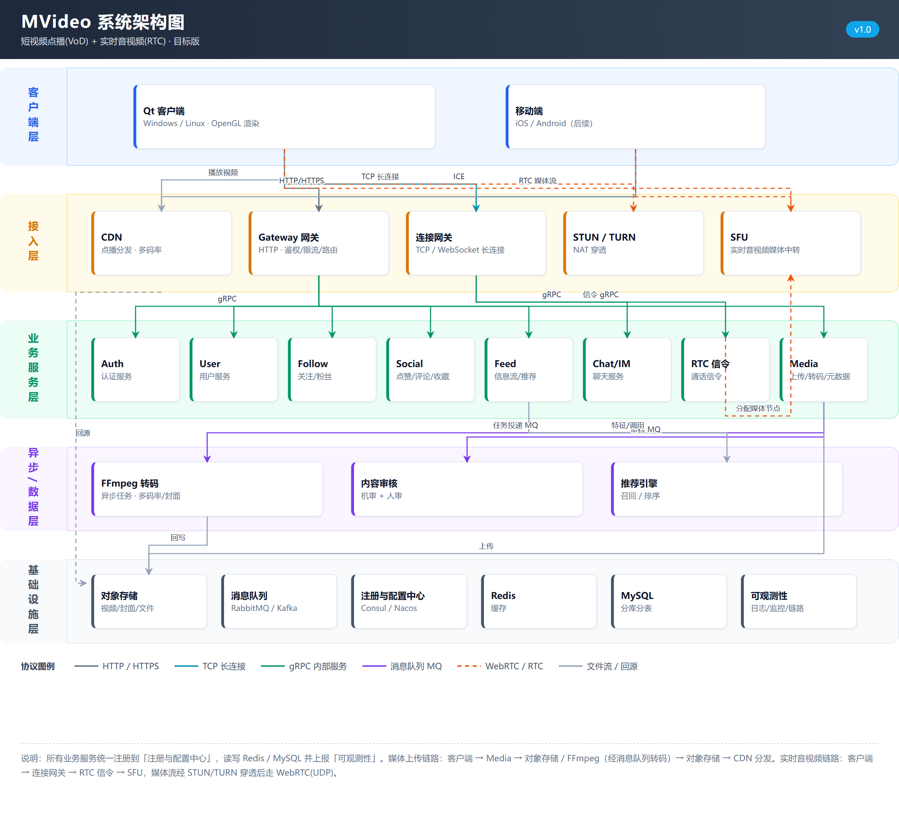

# MVideo

短视频点播（VoD）+ IM + 实时音视频（RTC）全链路学习项目。

[](https://github.com/mpt888666-collab/MVideo/actions/workflows/ci.yml)

> 当前阶段（2026-10）：账号网关已完成注册与邮箱验证码链路，并通过本机压测；IM 长连接、点播上传/转码、WebRTC 信令按路线图推进。

## 项目目标

MVideo 希望把一条完整的音视频链路跑通，而不是只做单点 Demo：

- **短视频点播**：上传 → 转码 → 封面/多码率 → 对象存储 → CDN 播放。
- **IM**：WebSocket 长连接、私聊/群聊、离线消息、ack/seq、消息幂等。
- **实时通讯**：WebRTC 信令、STUN/TURN 穿透、SFU 媒体转发。
- **客户端**：Qt + OpenGL 渲染，后续扩展移动端。

## 系统架构



> 图中是目标架构 v1.0，不代表所有模块都已实现。当前已落地的是账号网关、验证码服务、Redis、MySQL 这一条链路。

### 分层职责

| 层级 | 组件 | 职责 |
|---|---|---|
| 客户端层 | Qt 客户端 / 移动端 | 播放、拍摄、IM、OpenGL 渲染、RTC 采集与解码 |
| 接入层 | CDN | 点播分发、多码率、就近播放 |
| 接入层 | Gateway 网关 | HTTP 鉴权、限流、路由、参数校验 |
| 接入层 | 连接网关 | TCP / WebSocket 长连接、心跳、会话管理 |
| 接入层 | STUN / TURN | NAT 穿透、NAT 类型探测、中继兜底 |
| 接入层 | SFU | 多人实时音视频媒体转发 |
| 业务层 | Auth / User / Follow / Social / Feed | 账号、用户资料、关注粉丝、点赞评论收藏、信息流 |
| 业务层 | Chat/IM | 私聊、群聊、消息存储、离线消息、已读回执 |
| 业务层 | RTC 信令 | SDP / ICE 交换、通话状态、房间管理 |
| 业务层 | Media | 上传凭证、视频元数据、转码任务编排 |
| 异步层 | FFmpeg 转码 | 多码率、封面、HLS 切片 |
| 异步层 | 内容审核 / 推荐引擎 | 机审人审、召回与排序 |
| 基础设施 | 对象存储 / MQ / 配置中心 / Redis / MySQL / 可观测性 | 文件、异步任务、配置、缓存、持久化、日志监控链路 |

### 当前落地进度

| 模块 | 状态 | 说明 |
|---|---|---|
| HTTP 网关 | ✅ 已完成 | 注册、邮箱验证码、限流、过载保护、连接/包体限制 |
| 鉴权 | 🚧 部分完成 | 注册完成；登录、JWT、刷新、登出待做 |
| 验证码服务 | ✅ 已完成 | gRPC 调用 VarifyServer，SMTP 发送验证码 |
| MySQL | ✅ 已完成 | 连接池、事务写入 `user` / `user_info` |
| Redis | ✅ 已完成 | 验证码缓存、冷却键、Lua 原子限流 |
| IM | ⬜ 未开始 | WebSocket、私聊/群聊、离线消息、ack/seq |
| 点播 | ⬜ 未开始 | 预签名上传、FFmpeg 转码、HLS、CDN |
| RTC | ⬜ 未开始 | 信令、STUN/TURN、SFU |
| 客户端 | ⬜ 未开始 | Qt + OpenGL |

## 已完成：GetServer 账号网关

### 功能

- **邮箱验证码**：先查 Redis 缓存命中则直接返回；未命中才申请发送，避免重复打 SMTP。
- **冷却与配额**：同邮箱 60 秒冷却、同 IP 3 秒冷却；全局、邮箱、IP 多维度配额。
- **注册**：参数校验、PBKDF2-SHA256 密码哈希、`user` + `user_info` 同事务写入、重复账号/邮箱检查。
- **验证码消费**：注册成功后用 Lua 脚本原子校验并删除，避免并发重复使用。
- **过载保护**：连接数上限、请求头/包体限制、首请求/空闲/总超时、排队预算 2.5 秒，超时返回 503 并释放已占额度。

### 接口

| 方法 | 路径 | 状态 | 说明 |
|---|---|---|---|
| POST | `/get_varifycode` | ✅ | 获取邮箱验证码 |
| POST | `/user_register` | ✅ | 用户注册 |
| POST | `/login` | ⬜ | 登录并签发 JWT |
| POST | `/refresh` | ⬜ | 刷新 access token |
| GET | `/health` | ⬜ | 健康检查 |

### 服务端模块

```text
GetServer/
├── common/       Singleton、参数校验
├── config/       ini 配置加载
├── security/     PBKDF2-SHA256 密码哈希
├── db/           MySQL 连接池、用户写入
├── redis/        Redis 封装、Lua 限流、验证码存储
├── rpc/          VarifyServer gRPC 客户端
├── service/      注册、验证码业务编排
├── http/         路由注册与请求处理
└── net/          Asio / Beast 服务器与连接管理
```

> 服务端代码位于本仓库的 `GetServer/` 与 `VarifyServer/`。

### 关键设计

- **限流原子性**：多维度固定窗口限流放在一段 Lua 中执行，避免 GET + INCR 的竞态；返回 `0` 放行、`1..N` 命中第 N 条规则、`-1` 表示 Redis 异常。
- **先占坑再发送**：验证码发送前先用 `SET NX EX` 抢占邮箱/IP 冷却，发送失败再释放，防止并发重复发送。
- **失败回滚额度**：gRPC 失败或排队超时会释放已占用的限流额度，避免用户被“白扣”。
- **注册事务**：`user` 与 `user_info` 在同一 MySQL 连接、同一事务内写入，任一失败回滚。
- **密码存储**：PBKDF2-SHA256，120000 次迭代，数据库不保存明文密码。
- **连接保护**：最大连接数 4096、请求头 8 KB、包体 1 MB、每连接最多 1000 个请求，关闭前 drain 未读数据避免 RST。

## 数据库设计

Schema 和冒烟脚本：

- `docs/sql/schema.sql`：建库、建表、索引和外键
- `docs/sql/smoke.sql`：注册用户、关注、建会话、发消息、写已读位置的写入测试

| 表 | 作用 |
|---|---|
| `user` | 账号、邮箱、手机号、密码哈希 |
| `user_info` | 昵称、头像、简介、关注数、粉丝数 |
| `user_follow` | 有向关注关系，`status` 标记单向/互关；粉丝列表按 `followee_id` 查 |
| `chat_thread` | 会话主表，保存类型和会话列表排序用的最后消息冗余字段 |
| `private_chat` | 私聊会话与两个参与人，要求 `user1_id < user2_id` |
| `group_chat` | 群资料与群主 |
| `group_chat_member` | 群成员、角色、禁言截止时间 |
| `chat_message` | 消息事实表，`thread_msg_seq` 会话内唯一，`client_msg_id` 用于幂等 |
| `chat_message_read` | 每个用户在每个会话的已读位置，避免群聊消息行存多份已读状态 |

几个取舍：

- 关注和粉丝不拆两张表，统一用 `user_follow`；粉丝列表走 `idx_follow_followee_created`，不会出现两张表状态不一致。
- `chat_message` 不再存 `recv_id`；私聊接收者由 `private_chat` 决定，群聊接收者由 `group_chat_member` 决定。
- `status` 只表示消息是否撤回；“已读”是用户维度，放在 `chat_message_read.last_read_seq`。
- `chat_thread.last_msg_id` / `last_msg_at` 是刻意保留的冗余字段，用来避免会话列表每次聚合消息表。

## 压测结果

测试环境：Windows 10.0.26300，32 逻辑核，Release 构建，本机回环；Redis 5.0.14.1，MySQL 9.3.0；每轮 5 秒。

### 404 最小路径（HTTP 栈上限）

| 并发 | QPS | 平均 ms | p50 ms | p90 ms | p99 ms | 最大 ms |
|---:|---:|---:|---:|---:|---:|---:|
| 1 | 13,652 | 0.072 | 0.035 | 0.206 | 0.356 | 5.267 |
| 8 | 41,430 | 0.192 | 0.167 | 0.273 | 0.408 | 3.285 |
| 64 | 64,394 | 0.991 | 0.390 | 2.609 | 10.219 | 92.546 |
| 256 | 56,407 | 4.477 | 2.228 | 8.250 | 33.100 | 136.384 |

### 验证码缓存命中路径（真实业务路径）

| 并发 | QPS | 平均 ms | p50 ms | p90 ms | p99 ms | 最大 ms |
|---:|---:|---:|---:|---:|---:|---:|
| 1 | 1,864 | 0.535 | 0.510 | 0.667 | 0.944 | 6.600 |
| 8 | 9,218 | 0.866 | 0.813 | 1.246 | 2.034 | 16.918 |
| 32 | 8,598 | 3.717 | 3.383 | 6.891 | 12.449 | 33.602 |
| 64 | 8,647 | 7.390 | 6.858 | 12.331 | 19.519 | 46.329 |
| 128 | 10,622 | 12.029 | 13.137 | 15.319 | 21.432 | 39.925 |
| 256 | 9,959 | 25.655 | 26.951 | 29.832 | 62.118 | 126.768 |

### 注册路径

| 场景 | 成功数 | QPS | 平均 ms | p50 ms | p90 ms | 最大 ms |
|---|---:|---:|---:|---:|---:|---:|
| 单连接顺序 5 次 | 5/5 | 39.5 | 25.29 | 24.70 | 28.19 | 28.19 |
| 10 并发突发 | 10/10 | 69.7 | 142.32 | 142.13 | 142.62 | 142.82 |

### 结论

- HTTP 栈在 64 并发下约 **64k QPS**，但这只代表解析与连接管理上限，不代表业务容量。
- 验证码缓存命中约 **8.6k QPS（64 并发）**，p99 约 **21 ms**，常驻内存约 **25 MB**。
- 128 并发时 GetServer 5 秒仅消耗约 4.14s CPU（约 0.83 核），Redis 约 4.88s（接近单核打满），**当前瓶颈在 Redis 单实例，不在网关 CPU**。
- 注册吞吐被全局限流（20/s）和 IP 限流（10/min）刻意压住，压测数字只代表突发能力。
- Release 相比 Debug：404 路径约 **3.6 倍**，验证码路径约 **4.3 倍**；Debug 数据不能用于容量评估。

## 构建与运行

### 依赖

- CMake >= 3.25，C++20
- Boost（system / thread / filesystem）
- nlohmann-json
- gRPC + Protobuf
- OpenSSL
- redis-plus-plus
- libmysql
- Redis >= 5，MySQL >= 8

依赖通过 vcpkg 安装，项目会在未指定 toolchain 时尝试使用本机 vcpkg。

### 构建

```bash
cd GetServer
cmake -S . -B cmake-build-release -DCMAKE_BUILD_TYPE=Release
cmake --build cmake-build-release -j
```

Linux 使用 vcpkg 的 `libmysql` 时，需要叠加 `cmake/triplets/x64-linux-mvideo.cmake`。vcpkg 的 ncurses 6.5 默认是 wide-character，而 `libmysql` 的 CMake 没有设置 `CURSES_NEED_WIDE`，这个 triplet 会把该选项补上：

```bash
cd GetServer
cmake -S . -B cmake-build-release -DCMAKE_BUILD_TYPE=Release \
  -DVCPKG_OVERLAY_TRIPLETS=../cmake/triplets \
  -DVCPKG_TARGET_TRIPLET=x64-linux-mvideo
```

### 配置

`config.ini` 放在可执行文件工作目录，至少包含：

```ini
[GetServer]
Host = 0.0.0.0
Port = 8080
RpcThreads = 16
RpcQueueLimit = 64

[RedisServer]
Host = 127.0.0.1
Port = 6379
Db = 0
Size = 8

[MySQLServer]
Host = 127.0.0.1
User = root
Password = <your-password>
Db = MVideo
Port = 3306
Pool_size = 5

[VarifyServer]
Host = 127.0.0.1
Port = 50051
```

### 运行

```bash
./GetServer
```

启动前确保 Redis、MySQL、VarifyServer 可用；任一下游连接失败，进程会直接退出。

### VarifyServer

```bash
cd VarifyServer
npm install
cp config.example.json config.json
node server.js
```

把 `config.json` 中的邮箱授权码、MySQL 和 Redis 配置补全。`config.json` 已被 `.gitignore` 排除，不要提交真实密钥。

## 路线图

- [x] 邮箱验证码（缓存优先、冷却、多维度限流）
- [x] 用户注册（参数校验、密码哈希、事务写入）
- [x] 网关过载保护与基础压测
- [ ] 登录 / JWT / refresh / logout
- [ ] WebSocket 单聊：心跳、ack、seq、离线消息、幂等
- [ ] 群聊与消息 fanout
- [ ] MinIO 预签名上传 + FFmpeg 转码 + HLS 播放
- [ ] WebRTC 信令 + STUN/TURN
- [ ] Qt + OpenGL 客户端
- [x] CI（Linux/Windows 构建、MySQL schema 冒烟、vcpkg 依赖缓存）
- [ ] HTTPS、metrics、trace、优雅停机

## 已知限制

- 目前只有 HTTP，尚未接入 HTTPS；密码、验证码仍会明文传输，仅适合本机/内网演示。
- Redis 调用仍在 Asio I/O 线程内同步执行，Redis 抖动会阻塞同一 `io_context` 上的其他连接。
- 验证码和注册共用工作线程池，PBKDF2/MySQL 可能挤占验证码任务。
- 注册按 socket 对端 IP 限流，部署到 Nginx/LB 后需要可信代理与 `X-Forwarded-For` 解析。
- 单机、单 Redis 实例，没有水平扩展和跨节点消息路由。
- 架构图是目标版，IM、点播、RTC 尚未实现。
- 缺少 health/metrics、结构化日志、trace ID、优雅停机和自动化测试。

## 仓库说明

当前仓库包含架构文档、账号网关和验证码服务源码。目录：

```text
MVideo/
├── docs/architecture/   架构图与生成脚本
├── docs/sql/            数据库 schema 与冒烟脚本
├── GetServer/           账号网关与服务端代码
├── VarifyServer/        验证码 gRPC 服务
├── client/              Qt / OpenGL 客户端
└── README.md
```

构建产物、IDE 配置、日志、`config.ini` 和 `VarifyServer/config.json` 不应提交到仓库。

GitHub Actions 会在 push / PR 时校验 README、架构图、SQL schema，并在 Linux 和 Windows 上使用 vcpkg 构建 `GetServer`；数据库任务会在 MySQL 8.0 容器里实际执行 `schema.sql` 和 `smoke.sql`。

依赖分两层保存到 GitHub Actions Cache，并在下一次 CI 自动恢复：

- `.cache/vcpkg/tool`：vcpkg 本体，key 为 `vcpkg-tool-<os>-v2`。
- `.cache/vcpkg/downloads` + `.cache/vcpkg/bincache`：下载的源码包和编译好的二进制包，key 为 `vcpkg-pkgs-<os>-<triplet>-v2-<vcpkg.json 哈希>`，并通过 `restore-keys` 复用旧版本缓存。

缓存只在 CI 中读写，不会提交进 Git 仓库。GitHub 会在缓存 7 天未使用后自动清理，单仓库缓存总量上限为 10 GB；需要强制重建时，把 `ci.yml` 中的 `VCPKG_CACHE_VERSION` 从 `v2` 改成 `v3`。

## License

仅用于学习与作品展示，暂未选择开源许可证。
